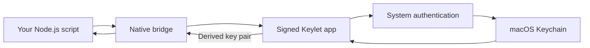

# Keylet

**A local key provider for Ethereum and Solana on macOS.**

[中文](README_ZH.md) · [Node.js API](node/README.md) · [Python API](python/README.md) · [Signing](docs/signing.md) · [Testing](docs/testing.md)

Keylet stores recovery phrases in macOS Keychain. Authenticate with Touch ID or your Mac password, then use the derived key with your own viem, ethers, or Ed25519 code.

It includes a native macOS app, `Keylet.app`, and SDKs for Node.js and Python. The SDK starts the signed app in the background when it needs a key.

The SDK's `getKeyPair()` returns the derived private key. Keep it in the calling process and out of logs or storage. [Local signers](#local-signing) use separate keys and return signatures instead.

**Not released yet.** Build the app and SDK from source using the steps below. Start with an unfunded test wallet; the project has not undergone an independent security audit.

```ts
import { getKeyPair } from 'keylet';
import { Wallet } from 'ethers';

const { privateKey } = await getKeyPair({
  name: 'trading', // Create or import this wallet in the app first.
  curve: 'secp256k1',
  index: 2,       // m/44'/60'/0'/0/2
});

const wallet = new Wallet(privateKey);
console.log(wallet.address); // Never log the private key or wallet object.
```

https://github.com/user-attachments/assets/3554d122-92ed-412b-bce7-057f6dcdcdff

## What it does

- Creates and imports English BIP-39 recovery phrases with an optional passphrase.
- Stores wallets behind macOS system authentication and a private Keychain access group.
- Lists wallet names and cached Ethereum / Solana addresses without unlocking secrets. Addresses for account indices 0–9 are cached when a wallet is created, imported, or synced.
- Copies Ethereum / Solana addresses by index or full derivation path under **Derived accounts** in wallet details. Cached indices copy directly; other indices and custom paths require authentication once, after which the address is remembered.
- Reveals a recovery phrase or deletes a wallet after authentication and explicit user action.
- Returns secp256k1 or SLIP-0010 Ed25519 key pairs through Node.js and Python APIs.
- Keeps device-local Ed25519 and secp256k1 [signers](#local-signing) that return signatures instead of keys, with optional time-limited signing sessions.

Useful for local scripts and developer tools that need derived keys, with recovery phrases stored in Keychain under macOS system authentication.

## Try it from source

- **Build requirements:** macOS 14+, Rust via rustup (the version is pinned in [`rust-toolchain.toml`](rust-toolchain.toml) and installed automatically), Apple command-line development tools, Python 3, Node.js 22+, and the pnpm version pinned in [`node/package.json`](node/package.json).
- **App signing:** a certificate and provisioning profile authorizing your bundle ID and private Keychain group. Follow [the free Personal Team setup](docs/signing.md#personal-team) for local development. Developer ID signing and notarized distribution require the publisher to join the paid Apple Developer Program; users of a future signed release will not need their own developer account.

The npm package does not include the macOS app. Build both before using the SDK.

1. Clone the repository:

   ```sh
   git clone https://github.com/nivek3/keylet.git keylet
   cd keylet
   ```

2. Build the app using your signing identity, profile, and authorized bundle ID:

   ```sh
   bash scripts/build-native.sh \
     'Apple Development: Your Name (TEAMID)' \
     '/absolute/path/App.provisionprofile' \
     'com.nivek3.keylet'
   open build/Keylet.app
   ```

   The Node SDK discovers Bundle ID `com.nivek3.keylet` through macOS and has no path override. Your profile must authorize this ID to build an app for the SDK. Keep an existing app's Bundle ID and Keychain group unchanged to retain wallet access; an older app with another ID remains separate from the SDK's lookup target.

3. Choose **Add wallet** or **+** and create or import a wallet named `trading`. For a new wallet, back up the seed phrase and verify all words. **Skip & save** saves the wallet without verifying the backup. For import, verify the account with an independently known Ethereum address or Ed25519 public key. Open **Seed phrase** in wallet details to view the saved phrase after macOS authentication.

4. Build the SDK and run an example:

   ```sh
   pnpm --dir node install --frozen-lockfile --ignore-scripts
   pnpm --dir node run build
   cd node
   node --import tsx examples/ethers-v6.ts trading 2
   ```

   Complete the macOS authentication prompt. The example prints the Ethereum address for index `2`. Other examples: [ethers v5](node/examples/ethers-v5.ts), [viem](node/examples/viem.ts), [Ed25519](node/examples/ed25519.ts).

After publication, install the SDK in your Node project with `npm install keylet`. The published package includes the compiled SDK; users do not need to build it. Install and open the complete app to register Bundle ID `com.nivek3.keylet` with macOS; discovery supports renamed apps. See the [API and troubleshooting guide](node/README.md).

Python users can install a macOS wheel or build the SDK from source. See the [Python installation and API guide](python/README.md).

## How it works



The signed app owns Keychain access. The SDK starts its background mode when it needs a key; no open wallet window is required.

### Key selection and Ed25519

`curve` is required. secp256k1 accepts an `index` (default `0`) or an explicit EVM `path`, but not both. Ed25519 requires an explicit hardened-only `path` and does not accept `index`:

```ts
const keys = await getKeyPair({
  name: 'trading',
  curve: 'ed25519',
  path: "m/44'/501'/2'/0'",
});
```

Both result fields are `0x` hex strings. Ed25519 returns a 32-byte child seed and a 32-byte public key, not a 64-byte Solana keypair; use Ed25519 tooling rather than ethers `Wallet`.

Recovering an existing account requires the original derivation path and BIP-39 passphrase. See the [Node.js API guide](node/README.md) for key formats, options, and examples.

## Security boundaries

**Keylet protects keys at rest, not after export.** Once returned, private keys are controlled by the calling process. Deleting a wallet or locking the Mac cannot revoke or erase exported copies. Never log or persist private keys.

- Keychain uses `WhenUnlockedThisDeviceOnly`, user-presence access control, and a private access group. The display cache holds only names and public addresses.
- Node calls reuse a process-local macOS authentication context without caching keys or failures. Save a duration in whole minutes in **… → Settings → Reuse Node auth**. The window starts after successful authentication and repeated calls do not extend it. The app stores the duration in its private Keychain group. The default is `0`, which requires authentication on every call. See the [API guide](node/README.md) for the per-call `authTTL` limit.
- App recovery-phrase reveals and deletions always authenticate separately. Recovery phrases are masked by default; reveals expire after 60 seconds and clear on focus loss, navigation, or Hide.
- Explicit clipboard copies are cleared after 60 seconds while the app runs, before blocking authentication, or on normal exit, provided the clipboard still contains the app's latest copy. Copies retained by other software cannot be revoked.
- The SDK requires a logged-in macOS session for interactive authentication. It does not target browsers, Linux/Windows servers, or unattended jobs.
- Keep an independent offline recovery backup. A BIP-39 passphrase changes the wallet; it is not the Mac login password. Never share secrets in issues or logs.

## Local signing

The signed macOS app can hold dedicated signing keys as separate entries in its private Keychain group. Signers are chain-agnostic: an Ed25519 signer covers Solana, and a secp256k1 signer covers Ethereum and Bitcoin. The CLI returns public keys and signatures, never private keys. The wallet SDK's `getKeyPair()` and the recovery phrase UI do not read signer entries.

```sh
keylet=./build/Keylet.app/Contents/MacOS/keylet
"$keylet" signer create sol                                # random Ed25519 key (default)
"$keylet" signer create evm --curve secp256k1              # random secp256k1 key
"$keylet" signer derive btc --wallet trading --curve secp256k1 --path "m/84'/0'/0'/0/0"
"$keylet" signer public-key evm
"$keylet" signer sign sol < message.bin
```

A signer is either a **random key** generated on this Mac, which has no backup, or a **copy derived from a wallet**. `derive` authenticates once to read the wallet, copies the key at `--path` into the signer entry, and never reads the recovery phrase again. The key can be recovered from the recovery phrase and path. Deleting the wallet does not delete the signer. secp256k1 accepts any BIP-32 path of up to ten levels; Ed25519 requires a hardened-only path.

`sign` reads raw bytes from standard input:

- **Ed25519**: 1 to 1232 bytes. For Solana, supply the serialized transaction **message**. Returns `publicKey`, the Base58 `address`, and a 64-byte `signature`.
- **secp256k1**: exactly one 32-byte digest, such as an Ethereum transaction hash, an EIP-191 or EIP-712 hash, or a Bitcoin sighash. Returns the 33-byte compressed `publicKey`, a 64-byte `signature` (`r || s`, low-S, RFC 6979), and `recoveryId` (0 or 1). The caller encodes it, for example `v = recoveryId + 27` or EIP-155 for Ethereum, or DER plus a sighash byte for Bitcoin. Taproot (Schnorr) is not supported.

Keylet does not derive chain addresses for secp256k1 signers; compute them from the public key. The caller builds, encodes, and submits the transaction.

### Signing sessions

`session` keeps one process open and signs one request per line, so a script can sign repeatedly without starting a new process:

```sh
"$keylet" signer session evm --ttl 300
{"payload":"0x<32-byte digest as hex>"}
```

Each response line has the same fields as `sign`. Any error ends the session. Set **… → Settings → Reuse signer auth** to let a session skip prompts for that many minutes after a successful authentication. `--ttl` can only shorten that window. The default is `0`, which prompts for every signature. The window does not extend with use, and the saved setting also applies to sessions already running. Each session process authenticates separately.

**Keylet signs blindly.** It never decodes payloads or applies transaction policies such as amount limits, allowlists, or swap checks; implement those in the calling service. Each prompt shows the signer, byte count, and the payload itself if it is 32 bytes or less (otherwise its SHA3-256 digest). The first prompt of a session also states the reuse window. During the window, the process holding the session can sign anything. Use a dedicated signer with limited funds, and keep the window short.

The [Node.js](node/README.md#sign-with-a-local-signer) and [Python](python/README.md#sign-with-a-local-signer) SDKs wrap sessions as `signWithSigner()` and `sign_with_signer()`. They verify every signature before returning it.

Signer keys are device-local and have no export command. To permanently remove a key, run `"$keylet" signer delete <name>` and authenticate.

## Development and documentation

[`crates/`](crates/) contains the app, derivation, shared bridge, and language bindings. [`node/`](node/) contains the TypeScript API and examples. [`python/`](python/) contains Python packaging and tests.

- [Node.js API and troubleshooting](node/README.md)
- [Build and signing](docs/signing.md), including [manual macOS release CI](docs/signing.md#manual-macos-release-ci)
- [Testing and interactive checks](docs/testing.md)
- [Node packaging and publishing](node/README.md#development-and-publishing)

The app builds with Cargo and scripts; Xcode is needed for Personal Team provisioning.

## Security and feedback

Bug reports should include macOS version, CPU architecture, Node/Bun version, app/SDK version, and the error code. Use public test fixtures for reproductions. Please report security issues through [GitHub private vulnerability reporting](https://github.com/nivek3/keylet/security/advisories/new).

## License

[MIT](LICENSE)
