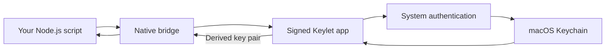

# Keylet

**A local key provider for Ethereum and Solana on macOS.**

[中文](README_ZH.md) · [Node.js API](node/README.md) · [Signing](docs/signing.md) · [Testing](docs/testing.md)

Keylet stores recovery phrases in macOS Keychain. Authenticate with Touch ID or your Mac password, then use the derived key with your own viem, ethers, or Ed25519 code.

It includes a native macOS app, `Keylet.app`, and a Node.js SDK, `keylet`. The SDK starts the signed app in the background when it needs a key.

Private keys are intentionally returned to your Node.js process. This is a key provider, not a hardware wallet or a remote signing service.

**Not released yet.** Build the app and SDK from source using the steps below. Start with an unfunded test wallet; the project has not undergone an independent security audit.

```ts
import { getKeyPair } from 'keylet';
import { Wallet } from 'ethers';

const { privateKey } = await getKeyPair({
  name: 'trading', // Create or import this wallet in the app first.
  curve: 'secp256k1',
  index: 2,       // m/44'/60'/0'/0/2
});

const wallet = new Wallet(privateKey);
console.log(wallet.address); // Never log the private key or wallet object.
```

https://github.com/user-attachments/assets/3554d122-92ed-412b-bce7-057f6dcdcdff

## What it does

- Creates and imports English BIP-39 recovery phrases with an optional passphrase.
- Stores wallets behind macOS system authentication and a private Keychain access group.
- Lists wallet names and default Ethereum / Solana addresses without unlocking secrets.
- Shows and copies Ethereum / Solana addresses by index or full derivation path after authentication, under **Derived account** in wallet details.
- Reveals a recovery phrase or deletes a wallet after authentication and explicit user action.
- Returns secp256k1 or SLIP-0010 Ed25519 key pairs through a small Node.js API.

Useful for local scripts and developer tools that need derived keys, with recovery phrases stored in Keychain under macOS system authentication.

## Try it from source

- **Build requirements:** macOS 14+, Rust, Apple command-line development tools, Python 3, Node.js 22+, and the pnpm version pinned in [`node/package.json`](node/package.json).
- **App signing:** a certificate and provisioning profile authorizing your bundle ID and private Keychain group. Follow [the free Personal Team setup](docs/signing.md#personal-team) for local development. Developer ID signing and notarized distribution require the publisher to join the paid Apple Developer Program; users of a future signed release will not need their own developer account.

The npm package does not include the macOS app. Build both before using the SDK.

1. Clone the repository:

   ```sh
   git clone https://github.com/nivek3/keylet.git keylet
   cd keylet
   ```

2. Build the app using your signing identity, profile, and authorized bundle ID:

   ```sh
   bash scripts/build-native.sh \
     'Apple Development: Your Name (TEAMID)' \
     '/absolute/path/App.provisionprofile' \
     'com.example.keylet'
   open build/Keylet.app
   ```

   Replace the example bundle ID with the one authorized by your profile. The app executable is `build/Keylet.app/Contents/MacOS/keylet`.

3. Click **+** and create or import a wallet named `trading`; examples do not create it automatically. Back up new recovery phrases and confirm all words, or explicitly choose **Skip** to save without verifying the backup. For import, verify the account with an independently known Ethereum address or Ed25519 public key. You can view a saved phrase through **Seed phrase**, after macOS authentication.

4. Build the SDK and run an example:

   ```sh
   pnpm --dir node install --frozen-lockfile --ignore-scripts
   pnpm --dir node run build
   cd node
   node --import tsx examples/ethers-v6.ts trading 2
   ```

   Complete the macOS authentication prompt. The example prints the Ethereum address for index `2`. Other examples: [ethers v5](node/examples/ethers-v5.ts), [viem](node/examples/viem.ts), [Ed25519](node/examples/ed25519.ts).

For another Node project, install the built SDK with `npm install /absolute/path/keylet/node`. Put the complete `Keylet.app` bundle in `~/Applications` or `/Applications`, or pass its executable's absolute path as `helperPath`. See the [API and troubleshooting guide](node/README.md).

## How it works



The signed app owns Keychain access. The SDK starts its background mode when it needs a key; no open wallet window is required.

### Key selection and Ed25519

`curve` is required. secp256k1 accepts an `index` (default `0`) or an explicit EVM `path`, but not both. Ed25519 requires an explicit hardened-only `path` and does not accept `index`:

```ts
const keys = await getKeyPair({
  name: 'trading',
  curve: 'ed25519',
  path: "m/44'/501'/2'/0'",
});
```

Both result fields are `0x` hex strings. Ed25519 returns a 32-byte child seed and a 32-byte public key, not a 64-byte Solana keypair; use Ed25519 tooling rather than ethers `Wallet`.

Recovering an existing account requires the original derivation path and BIP-39 passphrase. See the [Node.js API guide](node/README.md) for key formats, options, and examples.

## Security boundaries

**Keylet protects keys at rest, not after export.** Once returned, private keys are controlled by the calling process. Deleting a wallet or locking the Mac cannot revoke or erase exported copies. Never log or persist private keys.

- Keychain uses `WhenUnlockedThisDeviceOnly`, user-presence access control, and a private access group. The display cache holds only names and public addresses.
- Node calls reuse a process-local macOS authentication context without caching keys or failures. The default is 5 minutes from successful authentication; repeated calls do not extend it. In **… → Settings → Node authentication**, save a duration in whole minutes; `0` requires authentication on every call, and there is no policy maximum. See the [API guide](node/README.md) for the per-call `authenticationTtl` limit.
- App recovery-phrase reveals and deletions always authenticate separately. Recovery phrases are masked by default; reveals expire after 60 seconds and clear on focus loss, navigation, or Hide.
- Explicit clipboard copies are cleared after 60 seconds while the app runs, before blocking authentication, or on normal exit, provided the clipboard still contains the app's latest copy. Copies retained by other software cannot be revoked.
- The SDK requires a logged-in macOS session for interactive authentication. It does not target browsers, Linux/Windows servers, or unattended jobs.
- Keep an independent offline recovery backup. A BIP-39 passphrase changes the wallet; it is not the Mac login password. Never share secrets in issues or logs.

## Development and documentation

The app and native bridge are written in Rust, with a small TypeScript SDK. [`crates/`](crates/) contains the app, crypto, and napi-rs bridge; [`node/`](node/) contains the SDK and examples.

- [Node.js API and troubleshooting](node/README.md)
- [Build and signing](docs/signing.md), including [manual macOS release CI](docs/signing.md#manual-macos-release-ci)
- [Testing and interactive checks](docs/testing.md)
- [Node packaging and publishing](node/README.md#development-and-publishing)

The app builds with Cargo and scripts; Xcode is needed for Personal Team provisioning.

## Security and feedback

Bug reports should include macOS version, CPU architecture, Node/Bun version, app/SDK version, and the error code. Use public test fixtures for reproductions. Please report security issues through [GitHub private vulnerability reporting](https://github.com/nivek3/keylet/security/advisories/new).

## License

[MIT](LICENSE)
