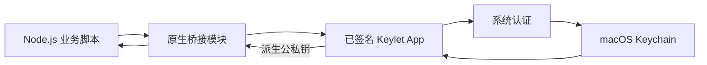

# Keylet

**为 Ethereum 和 Solana 提供密钥的 macOS 本机工具。**

[English](README.md) · [Node.js API](node/README_ZH.md) · [签名配置](docs/signing.md) · [测试](docs/testing.md)

Keylet 将助记词保存在 macOS Keychain，通过 Touch ID 或 Mac 登录密码认证，再把派生密钥交给自己的 viem、ethers 或 Ed25519 代码使用。

项目包含原生 macOS App `Keylet.app` 和 Node.js SDK `keylet`。SDK 需要密钥时，会在后台启动已签名的 App。

私钥会按设计返回给调用方的 Node.js 进程。项目是本机密钥提供器，不是硬件钱包或远程签名服务。

**当前尚未发布。** 请按下文从源码构建 App 和 SDK，先使用无资金的测试钱包；项目尚未接受独立安全审计。

```ts
import { getKeyPair } from 'keylet';
import { Wallet } from 'ethers';

const { privateKey } = await getKeyPair({
  name: 'trading', // 先在 App 中创建或导入这个名称的钱包。
  curve: 'secp256k1',
  index: 2,       // m/44'/60'/0'/0/2
});

const wallet = new Wallet(privateKey);
console.log(wallet.address); // 不要输出私钥或整个 wallet 对象。
```

https://github.com/user-attachments/assets/3554d122-92ed-412b-bce7-057f6dcdcdff

## 能做什么

- 创建、导入英文 BIP-39 助记词，支持可选附加口令。
- 使用私有 Keychain 访问组保存钱包，通过系统认证读取。
- 免密浏览钱包名称及默认 Ethereum / Solana 地址。
- 认证并明确操作后显示助记词或删除钱包。
- 通过简单的 Node.js API 返回 secp256k1 或 SLIP-0010 Ed25519 公私钥。

适用于需要派生密钥的本机脚本和开发工具，助记词由 Keychain 保存，访问受 macOS 系统认证控制。

## 从源码开始

- **构建环境：** macOS 14+、Rust、Apple 命令行开发工具、Python 3、Node.js 22+，以及 [`node/package.json`](node/package.json) 指定版本的 pnpm。
- **App 签名：** 需要签名证书，以及授权 bundle ID 和私有 Keychain 访问组的 provisioning profile。本地开发可按[免费 Personal Team 配置说明](docs/signing.md#personal-team)准备。Developer ID 签名和公证需要发布方加入付费 Apple Developer Program；未来安装正式签名版本的用户无需自己的开发者账号。

npm 包不包含 macOS App。使用 SDK 前，需要分别构建 App 和 SDK。

1. 克隆仓库：

   ```sh
   git clone https://github.com/nivek3/keychain-wallet.git keylet
   cd keylet
   ```

2. 使用自己的签名身份、profile 和获授权的 bundle ID 构建：

   ```sh
   bash scripts/build-native.sh \
     'Apple Development: Your Name (TEAMID)' \
     '/absolute/path/App.provisionprofile' \
     'com.example.keylet'
   open build/Keylet.app
   ```

   将示例 bundle ID 替换为 profile 实际授权的值。App 的可执行文件为 `build/Keylet.app/Contents/MacOS/keylet`。

3. 点击 **+**，创建或导入名为 `trading` 的钱包，示例不会自动创建它。新建时备份助记词并确认全部词，也可明确选择 **Skip**，不验证备份直接保存。导入时提供独立已知的 Ethereum 地址或 Ed25519 公钥核对账户。之后可通过 **Seed phrase**，经 macOS 认证查看已保存的助记词。

4. 构建 SDK 并运行示例：

   ```sh
   pnpm --dir node install --frozen-lockfile --ignore-scripts
   pnpm --dir node run build
   cd node
   node --import tsx examples/ethers-v6.ts trading 2
   ```

   在本机完成认证，示例会输出 `index: 2` 的 Ethereum 地址。另有 [ethers v5](node/examples/ethers-v5.ts)、[viem](node/examples/viem.ts)、[Ed25519](node/examples/ed25519.ts) 示例。

在其他 Node 项目中使用 `npm install /absolute/path/keylet/node` 安装已构建 SDK。将完整 `Keylet.app` 放进 `~/Applications` 或 `/Applications`，也可通过 `helperPath` 指定包内可执行文件的绝对路径。详见 [API 与故障排查](node/README_ZH.md)。

## 工作方式



已签名 App 负责 Keychain 访问。SDK 需要密钥时会启动 App 的后台模式，无需一直打开钱包窗口。

### 密钥选择与 Ed25519

`curve` 必传。secp256k1 接受 `index`（默认 `0`）或完整 EVM `path`，两者不能同时传。Ed25519 必须显式指定仅含 hardened 派生的完整 `path`，不接受 `index`：

```ts
const keys = await getKeyPair({
  name: 'trading',
  curve: 'ed25519',
  path: "m/44'/501'/2'/0'",
});
```

结果均为带 `0x` 前缀的十六进制字符串。Ed25519 返回 32 字节子 seed 和 32 字节公钥，不是 64 字节 Solana keypair；应使用 Ed25519 工具，不能传给 ethers `Wallet` 来获得对应 Solana 账户。

恢复现有账户必须使用原派生路径和 BIP-39 附加口令。密钥格式、参数和示例详见 [Node.js API 文档](node/README_ZH.md)。

## 安全边界

**Keylet 保护密钥的存储，导出后的私钥由调用进程控制。** 删除钱包或锁屏都无法撤回或清除已导出的副本。不要记录或持久化私钥。

- 使用 `WhenUnlockedThisDeviceOnly`、用户在场认证和私有 Keychain 访问组。本机展示清单仅缓存名称与公开地址。
- Node 调用在当前进程内复用 macOS 认证上下文，不缓存密钥或失败结果。默认从认证成功起计时 5 分钟，连续调用不会续期。在 **… → Settings → Node authentication** 中输入整数分钟并保存；`0` 表示每次认证，不设业务上限。单次调用的 `authenticationTtl` 限制见 [API 文档](node/README_ZH.md)。
- App 内显示助记词和删除钱包始终单独认证。助记词默认遮罩，显示 60 秒、失焦、离开页面或点击 Hide 后清除。
- 显式复制的内容在应用运行期间 60 秒后、阻塞认证前或正常退出时清理，前提是剪贴板仍为本应用最后一次写入。无法撤回其他软件保留的副本。
- SDK 需要已登录的 macOS 会话完成交互认证，不面向浏览器、Linux/Windows 服务或无人值守任务。
- 保留独立离线备份。BIP-39 附加口令会改变钱包，它不是 Mac 登录密码。不要在 issue 或日志中发送秘密。

## 开发与文档

App 和原生桥接模块使用 Rust，SDK 使用少量 TypeScript。[`crates/`](crates/) 包含 App、密钥派生和 napi-rs 桥接；[`node/`](node/) 包含 SDK 与示例。

- [Node.js API 与故障排查](node/README_ZH.md)
- [构建与签名](docs/signing.md)，包含 [macOS 手动发布 CI](docs/signing.md#manual-macos-release-ci)
- [测试与交互检查](docs/testing.md)
- [Node 打包与发布](node/README_ZH.md#开发与发布)

App 使用 Cargo 和脚本构建，Xcode 用于 Personal Team provisioning。

## 安全与反馈

报告问题时请提供 macOS 版本、CPU 架构、Node/Bun 版本、App/SDK 版本及错误码。复现只使用公开测试数据；安全问题请使用 [GitHub 私密漏洞报告](https://github.com/nivek3/keychain-wallet/security/advisories/new)。

## 许可证

[MIT](LICENSE)
